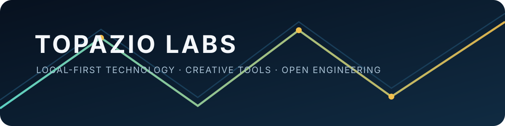

  

# Topazio Labs

Independent engineering for local-first tools, creative software, intelligent systems and accessible technology.

Topazio Labs is an independent laboratory—not a claim of a formal company or staffed organization. The work explores software engineering, artificial intelligence, electronics, automation, local computing, creative tools, embedded systems and experimental blockchain.

## Projects to explore

| Project | What it is | Current public evidence |
| --- | --- | --- |
| [Fabuloom Studio](https://github.com/0xTPZ/fabuloom) | Local-first editor for scripts, scenes, character packs, camera motion, narration and MP4 export. | Alpha 0.1.0 is in preparation; [institutional site](https://0xtpz.github.io/fabuloom/). |
| [Voltrama Studio](https://github.com/0xTPZ/voltrama-studio) | Open-source foundation for electronic engineering workflows and component knowledge. | Active staged development; several dependent draft PRs remain under review. |
| [Topázio Microscope](https://github.com/0xTPZ/topazio-microscope) | Python tool for USB microscope inspection and electronics repair workflows. | Public v0.2 work exists; license and distribution boundaries still need owner review. |
| [Topazio Mobile Server OS](https://github.com/0xTPZ/TopazioMobileServerOS) | Experimental ARM64/mobile systems research. | Public research repository; hardware compatibility is not claimed beyond documented evidence. |
| [LocalCoder](https://github.com/0xTPZ/LocalCoder) | Experimental local programming-agent project. | Public repository; architecture and limitations should be read before use. |

## How the lab works

The guiding principles are privacy, local execution, user autonomy, transparent limitations and accessible engineering. A README or release is not treated as proof of a feature: demonstrations, tests and documented boundaries matter.

For project-specific questions, use the repository's issues and documentation. Do not assume that every open PR is ready to merge; many are staged experiments or dependent work.

## Historical work

The following repositories are preserved as technical references and are not presented as production-ready products:

- [Topazio History](https://github.com/0xTPZ/topazio-history)
- [TopazioCoin Genesis](https://github.com/0xTPZ/topaziocoin-genesis)
- [TopazioCoin PHP History](https://github.com/0xTPZ/topaziocoin-php-history)
- [Topazio Network G1](https://github.com/0xTPZ/topazio-network-generation-1)

## Contributing

Start with the target repository's README, issues, license and contribution guidance. If a project does not define a contribution policy, open a focused issue first rather than assuming that a broad change is welcome.

## Language

[Leia em português brasileiro](./README.pt-BR.md).

## Portfolio transparency

This profile is maintained as a public map of independently developed work. The sanitized inventory and PR matrix in [`reports/`](./reports/) record what was observed on GitHub on 2026-11-01/02; they are not a substitute for project documentation or owner approval.
