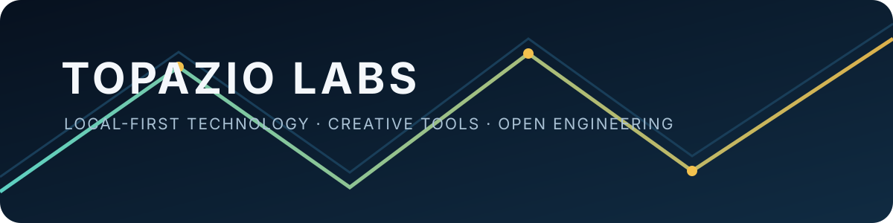

  

# Topazio Labs

Engenharia independente para ferramentas locais, software criativo, sistemas inteligentes e tecnologia acessível.

Topazio Labs é um laboratório independente — isso não afirma a existência de uma empresa formal ou de uma equipe contratada. O trabalho explora engenharia de software, inteligência artificial, eletrônica, automação, computação local, ferramentas criativas, sistemas embarcados e blockchain experimental.

## Projetos para conhecer

| Projeto | O que é | Evidência pública atual |
| --- | --- | --- |
| [Fabuloom Studio](https://github.com/0xTPZ/fabuloom) | Editor local-first para roteiros, cenas, packs de personagens, câmera, narração e exportação MP4. | Alpha 0.1.0 em preparação; [site institucional](https://0xtpz.github.io/fabuloom/). |
| [Voltrama Studio](https://github.com/0xTPZ/voltrama-studio) | Base aberta para fluxos de engenharia eletrônica e conhecimento de componentes. | Desenvolvimento ativo em etapas; várias PRs dependentes em Draft. |
| [Topázio Microscope](https://github.com/0xTPZ/topazio-microscope) | Ferramenta Python para inspeção com microscópio USB e reparos eletrônicos. | Existe trabalho público v0.2; licença e distribuição ainda exigem revisão do proprietário. |
| [Topazio Mobile Server OS](https://github.com/0xTPZ/TopazioMobileServerOS) | Pesquisa experimental de sistemas ARM64/móveis. | Repositório público de pesquisa; não se afirma compatibilidade além das evidências documentadas. |
| [LocalCoder](https://github.com/0xTPZ/LocalCoder) | Projeto experimental de agente local de programação. | Repositório público; leia arquitetura e limitações antes de usar. |

## Como o laboratório trabalha

Os princípios são privacidade, execução local, autonomia do usuário, limitações transparentes e engenharia acessível. Um README ou release não é tratado como prova de uma funcionalidade: demonstrações, testes e limites documentados importam.

Para dúvidas, use as issues e a documentação de cada projeto. Não presuma que toda PR aberta está pronta para merge; muitas são experimentos em etapas ou dependem de outras mudanças.

## Trabalho histórico

Os repositórios abaixo são preservados como referências técnicas e não são apresentados como produtos prontos para produção:

- [Topazio History](https://github.com/0xTPZ/topazio-history)
- [TopazioCoin Genesis](https://github.com/0xTPZ/topaziocoin-genesis)
- [TopazioCoin PHP History](https://github.com/0xTPZ/topaziocoin-php-history)
- [Topazio Network G1](https://github.com/0xTPZ/topazio-network-generation-1)

## Contribuições

Comece pelo README, issues, licença e orientações do repositório escolhido. Se o projeto não definir uma política de contribuição, abra primeiro uma issue objetiva em vez de presumir que uma alteração ampla seja desejada.

## Idioma

[Read in English](./README.md).

## Transparência do portfólio

Este perfil é um mapa público do trabalho desenvolvido de forma independente. O inventário sanitizado e a matriz de PRs em [`reports/`](./reports/) registram o que foi observado no GitHub em 01/02-11-2026; eles não substituem a documentação de cada projeto nem a aprovação do proprietário.
